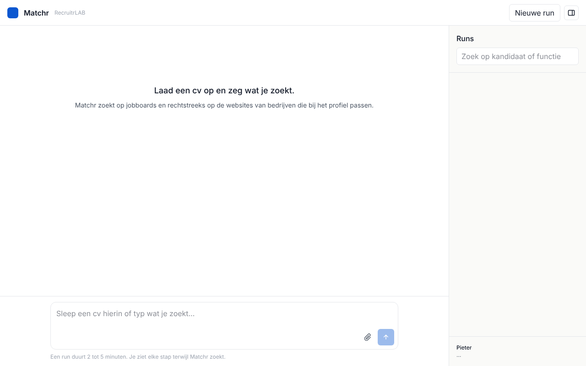

# MatchrLab

Interne tool van RecruitrLAB. Een collega laadt een cv op plus wat vrije tekst, en Matchr zoekt zelf gericht vacatures: op jobboards én rechtstreeks op de websites van bedrijven die het per cv ontdekt. De interface voelt als een chat; elke zoekstap is live zichtbaar.

Stack: Next.js 16 (App Router, TypeScript, Tailwind 4), Neon Postgres via Drizzle, OpenAI (gpt-5-mini) met Claude Haiku als reserve, zoekketen Linkup/Tavily/Exa, Adzuna, Jooble, Jina Reader, Firecrawl. Draait op Vercel.



## Hoe een run verloopt

Een run is een reeks korte stappen. De browser roept `POST /api/runs/:id/step` telkens opnieuw aan tot de status `done` of `failed` is; elke aanroep streamt zijn voortgang als Server-Sent Events en schrijft zijn resultaat weg. Daardoor loopt een run van vijf minuten nooit stuk op één functie-timeout, en kan een afgebroken run gewoon hervat worden (open de run in de zijbalk).

| Stap | Wat gebeurt er | Model |
| --- | --- | --- |
| 1 Profiel | cv (pdf/docx) + vrije tekst → functietitels, skills, senioriteit, regio + straal, uitsluitingen, 6-8 zoekqueries | Haiku |
| 2 Jobboards | Adzuna (be-endpoint) en VDAB, parallel. Filter op regio en uitsluitingen vóór enige LLM-call | geen |
| 3 Bedrijven ontdekken | Haiku bedenkt 5-8 zoekopdrachten ("maakbedrijven ploegenwerk regio Mechelen"), Brave zoekt, resultaten → max 80 unieke domeinen minus de blocklist. Bedrijven die < 7 dagen geleden gecrawld zijn worden overgeslagen; hun bestaande vacatures gaan mee | Haiku |
| 4 Jobpagina vinden | per domein, goedkoop-eerst: ATS-detectie → standaardpaden → Haiku kiest uit de homepage-links → Brave `site:domein vacature`. Niets gevonden → `ats = none`, niet opnieuw proberen | Haiku (enkel 4c) |
| 5 Vacatures extraheren | ATS-feed als die er is, anders Haiku op de paginatekst (gewone fetch, Jina Reader voor JS-shells, alles door `page_cache`). Enkel titels → max 10 detailpagina's | Haiku |
| 6 Scoren | dedupliceren op url en titel+bedrijf, voorselectie over alles, top-30 krijgt een score op 10 met argument en risico | licht model |

Vervolgberichten in dezelfde thread: Haiku beslist of het een verfijning is (profiel aanpassen, opnieuw zoeken vanaf stap 2; eerder bezochte bedrijven worden hergebruikt) of een vraag over de resultaten (wordt beantwoord zonder nieuwe zoektocht). Klikken op een parameter-chip start een run met aangepaste parameters.

Code: `src/lib/pipeline/` (één bestand per stap, elk met input/output-types), `src/lib/pipeline/orchestrator.ts` (stapmachine), `src/lib/ats/` (adapters), `src/lib/blocklist.ts`, `src/lib/geo.ts`.

### VDAB

De officiële VDAB-vacature-API vereist partnerregistratie op developer.vdab.be (IBM API Connect) en is niet publiek; de data mag bovendien enkel ongewijzigd herpubliceerd worden. Tot die toegang er is zoekt Matchr VDAB-vacatures via Brave met `site:vdab.be/vindeenjob`, wat per run 2 queries kost en enkel titel, url en snippet oplevert. Een echte VDAB-adapter hoort in `src/lib/pipeline/jobboards.ts` naast Adzuna.

## Wat een run oplevert

Cv erin, passende vacatures eruit: de kandidaat in 3 regels met zijn onzekerheden, tot 10 vacatures (max 2 per
werkgever), elk met een score op 10 (kerntaken 3, vaardigheden 3, senioriteit 2, sector 1, mobiliteit 1), één argument
en één risico, en max 3 open vragen aan de kandidaat. Enkel rechtstreekse werkgevers met vast contract binnen de straal;
interim, freelance, tijdelijk, bureaus, harde blokkades en alles onder 6/10 vallen weg. Geen outreach, geen drafts.

## AI-model: OpenAI (standaard), Claude optioneel

Alle AI-aanroepen lopen via `llmJson` in `src/lib/llm.ts`. `AI_PROVIDER` staat standaard op `openai`; `auto` geeft
OpenAI met Claude als reserve, `anthropic` enkel Claude. Er staat geen modelnaam vast in de code: met de key vraagt
Matchr `/v1/models` op (1 uur cache) en kiest het nieuwste lichte model (mini > luna > nano). In Instellingen kies je
eventueel een ander uit de lijst. Parameters die een model niet ondersteunt (reasoning_effort, json_schema) laat
Matchr bij een tweede poging weg. Een ChatGPT-abonnement bevat geen API-tegoed: de key komt van platform.openai.com.

## Toegang

Collega's geven enkel hun naam (voor "wie deed welke run"); er is geen wachtwoord, ook niet voor `/admin`. Opgeslagen keys worden nooit getoond; Instellingen houdt bij wie een key het laatst wijzigde. Wie de URL kent kan runs starten en keys vervangen; het maandbudget begrenst de kosten. `APP_PASSWORD` blijft nodig als sleutel voor sessiecookies en de versleuteling van keys.

## API-keys en instellingen: /admin

Na het aanmelden staat rechtsboven **Instellingen** (`/admin`). Daar plak je de API-keys; ze worden versleuteld opgeslagen in de tabel `settings` (AES-256-GCM, sleutel afgeleid van `APP_PASSWORD`) en nooit meer getoond. Een waarde in `/admin` gaat voor op de omgevingsvariabele met dezelfde naam. Wijzig je `APP_PASSWORD`, dan moeten de keys opnieuw ingevuld worden.

Enkel `DATABASE_URL` en `APP_PASSWORD` moeten in Vercel staan; al de rest kan via `/admin`.

### Zoekmachine

Bedrijfsontdekking, VDAB en de fallback bij jobpagina's gebruiken één zoekketen (`src/lib/search.ts`). Elke provider met
een key wordt in volgorde geprobeerd; faalt er één (geen key, limiet op, HTTP-fout), dan gaat hij 10 minuten in afkoeling
en neemt de volgende over.

| Provider | Key | Gratis | Opmerking |
| --- | --- | --- | --- |
| Linkup | `LINKUP_API_KEY` | ±4.000 zoekopdrachten/maand met professioneel e-mailadres | eerste keuze |
| Tavily | `TAVILY_API_KEY` | 1.000 credits/maand | |
| Exa | `EXA_API_KEY` | ±$10/maand | |
| Brave | `BRAVE_SEARCH_API_KEY` | $5 tegoed/maand, kaart nodig | optioneel |
| Claude web search | `ANTHROPIC_API_KEY` | betalend, ±$0,01/zoekopdracht | enkel als `SEARCH_PROVIDER=anthropic` |

`SEARCH_PROVIDER` = auto (standaard) volgt deze volgorde zonder Claude; een vaste keuze zet die provider vooraan.
Google Custom Search is gesloten voor nieuwe klanten (sinds 20 januari 2026, stopt 1 januari 2027); DuckDuckGo blokkeert Vercel.

### Vacaturebronnen en pagina's lezen

Adzuna en Jooble (`JOOBLE_API_KEY`, key per landendomein, voor België via be.jooble.org) als jobboards; publieke ATS-feeds
zonder key; pagina's via gewone fetch, dan Jina Reader, dan Firecrawl (`FIRECRAWL_API_KEY`, 1.000 credits/maand gratis).

In Instellingen staat de flow per stap met de status van elke tool en een testknop.

## Omgevingsvariabelen

Zie `.env.example`. Lokaal in `.env.local`, op Vercel onder Settings → Environment Variables. Nooit waarden committen. Alles behalve `DATABASE_URL` en `APP_PASSWORD` kan ook via `/admin`.

| Naam | Verplicht | Waarvoor |
| --- | --- | --- |
| `OPENAI_API_KEY` / `ANTHROPIC_API_KEY` | één van beide | OpenAI eerst, Claude als reserve |
| `DATABASE_URL` | ja | Neon Postgres (pooled connection string) |
| `APP_PASSWORD` | ja | gedeeld teamwachtwoord; ook de sleutel waarmee sessiecookies getekend worden |
| `BRAVE_SEARCH_API_KEY` | nee | zonder Brave of Google zoekt Matchr via DuckDuckGo |
| `LINKUP_API_KEY`, `TAVILY_API_KEY`, `EXA_API_KEY` | nee | gratis zoekketen; zonder keys enkel Claude web search |
| `JOOBLE_API_KEY`, `FIRECRAWL_API_KEY` | nee | extra vacaturebron en zware jobsites lezen |
| `SEARCH_PROVIDER` | nee (standaard auto) | auto, linkup, tavily, exa, brave of anthropic |
| `ADZUNA_APP_ID`, `ADZUNA_APP_KEY` | nee | zonder deze wordt Adzuna overgeslagen |
| `JINA_API_KEY` | nee | r.jina.ai werkt zonder key op de gratis tier; een key geeft hogere limieten |
| `ANTHROPIC_MONTHLY_BUDGET_EUR` | nee (standaard 50) | boven dit maandtotaal worden nieuwe runs geweigerd |

## Database

```bash
npm run db:generate   # nieuwe migratie na een schema-wijziging in src/lib/db/schema.ts
npm run db:migrate    # lokaal; op Vercel draait dit automatisch bij elke build (scripts/migrate-if-configured.mjs)
```

Tabellen: `runs`, `messages`, `companies`, `jobs`, `matches`, `page_cache` (TTL 7 dagen), `usage_counters` (Brave-teller per maand), `settings` (keys en instellingen uit /admin, versleuteld). `runs.state` bevat de stapvoortgang en cursors zodat een run hervat kan worden.

## Lokaal draaien

```bash
npm install
cp .env.example .env.local   # waarden invullen
npm run db:migrate
npm run dev
```

Controle: `npm run verify` (typecheck, lint, tests, build). End-to-end zonder UI: `npm run demo` draait de pijplijn op `test/fixtures/cv-procesoperator.pdf` en faalt als er minder dan 10 vacatures of minder dan 3 van bedrijfssites uitkomen. Het voorbeeld-cv is fictief en wordt gemaakt door `npm run fixture:cv`.

## Een ATS of bron toevoegen

**ATS** (vacatures op de bedrijfssite): maak `src/lib/ats/<naam>.ts` met een `AtsAdapter`:

- `detect(html, links)`: zoek de signatuur in de homepage-HTML en geef de account-slug terug;
- `listingUrl(slug)`: de publieke vacaturepagina, gebruikt als de feed faalt;
- `fetchJobs(slug)`: de publieke feed, of `null` als er geen is (dan doet Haiku de extractie op `listingUrl`);
- zet hem in de lijst in `src/lib/ats/index.ts` en voeg de naam toe aan `atsEnum` in `src/lib/db/schema.ts` (+ `npm run db:generate`).

Status per ATS:

| ATS | Endpoint | Geverifieerd tegen een echte account |
| --- | --- | --- |
| Recruitee | `GET https://{slug}.recruitee.com/api/offers/` | ja |
| Greenhouse | `GET https://boards-api.greenhouse.io/v1/boards/{slug}/jobs?content=true` | ja |
| Lever | `GET https://api.lever.co/v0/postings/{slug}?mode=json` | ja |
| SmartRecruiters | `GET https://api.smartrecruiters.com/v1/companies/{company}/postings` | ja |
| Workable | `POST https://apply.workable.com/api/v3/accounts/{slug}/jobs` | nee |
| Teamtailor | `GET https://{slug}.teamtailor.com/jobs.rss` | nee |
| Personio | `GET https://{slug}.jobs.personio.de/xml` | nee |
| Jobtoolz | geen publieke feed bekend; career site via generieke extractie | n.v.t. |
| Talentfinder | geen publieke feed bekend; career page via generieke extractie | n.v.t. |

**Jobboard** (externe bron): voeg een functie toe in `src/lib/pipeline/jobboards.ts` die `NormalizedJob[]` teruggeeft, roep ze aan in `searchJobboards`, en voeg de bron toe aan `jobSourceEnum` in het schema en aan `sourceLabel` in `src/components/Thread.tsx`.

## Kostenregels

Doel: < € 0,15 per run en < € 50 per maand bij 15 runs/dag. Alles wat kost staat in `src/lib/config.ts`.

- Overal het lichte model (gpt-5-mini of Claude Haiku), ook voor de eindscoring van de top-30. Modelnamen en prijzen in `config.ts`.
- Geen pagina twee keer binnen 7 dagen (`page_cache`), geen bedrijf twee keer binnen 7 dagen (`companies.last_crawled_at`).
- Per run: max 80 domeinen, max 10 detailpagina's per bedrijf, max 30 vacatures naar de eindscoring, max 12 Brave-queries.
- Brave: maandteller in `usage_counters`; boven 1900 stoppen we met zoeken en gaat de run verder zonder nieuwe bedrijven.
- Elke LLM-call telt tokens × prijs (USD → EUR × 0,92) op in `runs.cost_estimate_eur`. De zijbalk toont de som per week en per maand.
- Overschrijdt het maandtotaal `ANTHROPIC_MONTHLY_BUDGET_EUR`, dan weigert `POST /api/runs` nieuwe runs met een duidelijke melding (HTTP 402).
- Vercel: `maxDuration = 300` op de step-route; de crawlstap geeft na 45 s de controle terug aan de client en gaat bij de volgende aanroep verder waar hij was.

Ruwe schatting per run met lichte modellen: enkele centen aan AI, zoeken gratis via de zoekketen.

## Niet in fase 1

Geen Indeed/LinkedIn-scraping, geen proxydiensten, geen vector-database, geen aparte Python-service, geen gebruikersbeheer, geen e-mail.
